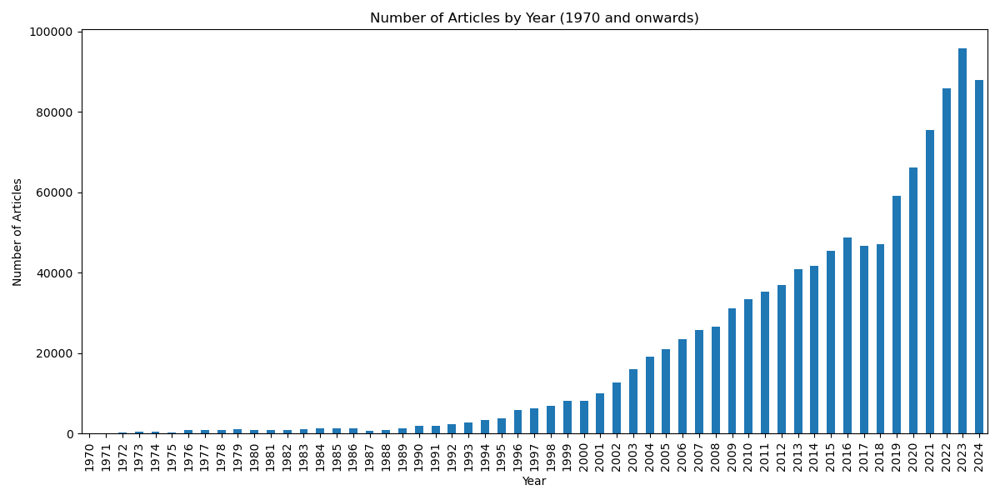
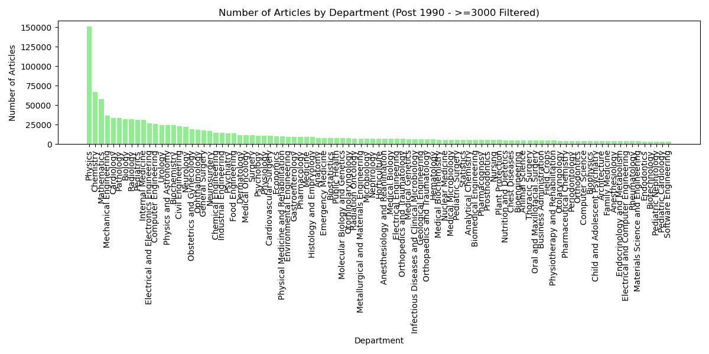
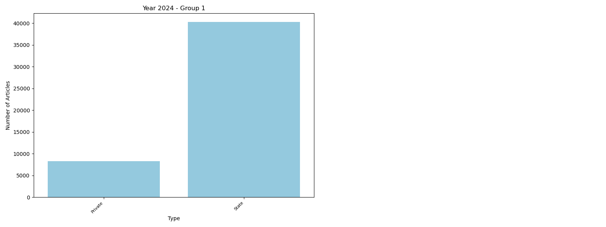
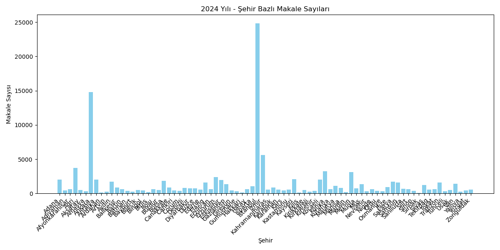

# Academic Publication Analysis — Scopus and University Data

**Graduate coursework at Özyeğin University — CS552.A, Data Science with Python.** Emre Öztürk and Ali Baki Türköz carried out all stages jointly and equally. This public coursework archive explains an exploratory study of academic publication records and university information in Turkey.

## What problem was addressed?
Records from different sources use inconsistent name order, Turkish/English spelling and institution names. People with the same name can be confused. The study prepared and matched Scopus/university information, then explored how recorded publication counts vary by year, city, institution type and department.

## What was done and how?
Course materials describe data collection, text/name standardization, spelling cleanup, name-plus-institution matching and exploratory summaries using Scopus and YÖK Atlas information. The surviving outputs include aggregate charts. **Original Python scripts have now been recovered** from the VSCode archive: Selenium collection, name/character cleanup, author-affiliation processing, prototype matching and aggregation. The archive now includes complete relevant scripts, available original research workbooks, course reports and a full gallery, alongside five introductory excerpts. Some raw Scopus inputs referenced by the scripts are still missing; the available workbooks are not the complete original publication corpus. The earlier Word document contained placeholders, but it is no longer the only available code source. See [recovered-code scope](docs/RECOVERED_CODE.md).

## Read the full archive

Start with the research question above, then follow the workflow: collect/reference university information → normalize names and affiliations → form prototype matches → summarize records by year/city/institution/department → interpret the archived figures. Name-only prototype joins and different counting units limit conclusions; neither identity accuracy nor causal effects are established by a plot.

- [Complete recovered source](source/README.md): full relevant historical scripts, with path-only sanitation.
- [Available research data](data/research/README.md): original matched records and reference tables, with schemas and missing-input details.
- [Original course presentation and reports](reports/README.md).
- [Full result gallery](assets/full_analysis/README.md): all distinct publication-analysis figures found in this workspace.
- [Full archive provenance](docs/FULL_ARCHIVE_MANIFEST.json).

## Archived outputs

*Source chart: 1970 onward. An upward pattern in recorded totals is visible; these are not independently verified unique nationwide paper counts.*

*Post-1990 source view, filtered to departments with at least 3,000 recorded articles. Similar counts do not prove collaboration.*

*State/private counts in the source's 2024 Group 1 subset; subset selection is not documented here.*

*City-level 2024 aggregate view. Collection coverage and counting units limit interpretation.*

[Output scope and limitations](results/README.md), [method and study context](docs/PROJECT_CONTEXT.md).

## Selected original code and small data illustration
- [Recovered original functions and matching excerpt](examples/README.md): text normalization, author/affiliation cleanup, name formatting, name-only join logic and historic pagination XPath.
- [Later aggregate-processing example](examples/aggregate_counts.py), explicitly separate from the recovered code.
- [Four fabricated institution/year rows](data/synthetic_institution_counts.csv), unrelated to the archived graph values.
- [Image and code source manifest](docs/SOURCE_MANIFEST.json).

## Original materials recovered — 16 October 2026
[Recovered materials and execution limitations](docs/RECOVERED_MATERIALS.md) · [File provenance manifest](docs/WORKSPACE_SYNC_MANIFEST.json). No reported experiment was rerun.

## Original Scopus workbooks
The two [original input workbooks](data/raw_scopus/README.md) are included in full with source checksums. No records were regenerated or reformatted.

## Additional CS552 materials
[University collection-table archive](data/university_archives/README.md) · [EmreAI design/report study](docs/EMREAI_DESIGN_STUDY.md) · [Working-note scope](reports/working_notes/README.md). EmreAI remained a design/report project; no installable library is claimed.

## Setup and archive validation
[Environment, paths and execution scope](RUNNING.md). Run `python tools/check_archive.py` to verify the archive without training.
